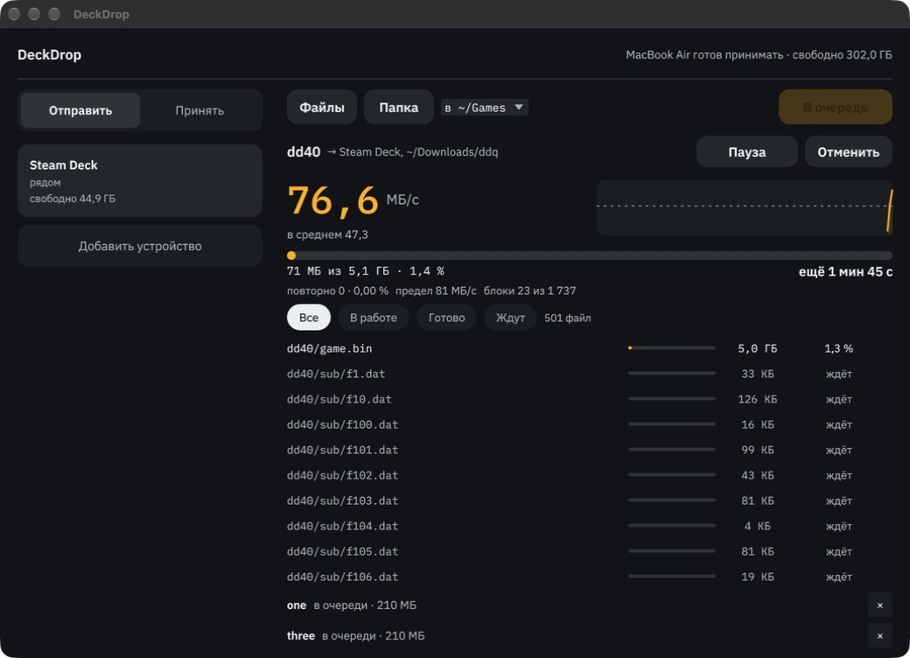
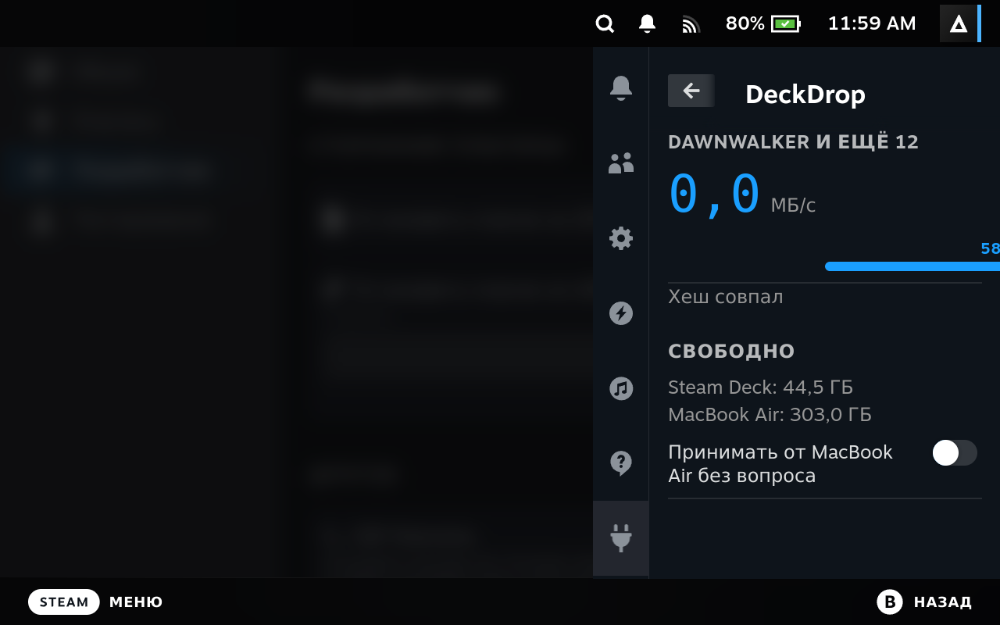

# DeckDrop

Быстрая передача файлов между Маком (Apple Silicon) и Steam Deck по локальной сети.

Служба держит всю передачу. Окно, панель Decky, командная строка и MCP-сервер только управляют ею через локальный сокет, поэтому закрытое окно передачу не прерывает.





## Что умеет

- Папки с файлами 40+ ГБ, структура папок и mtime сохраняются.
- Повтор потерь, автоподбор скорости, пауза, продолжение после обрыва и перезапуска службы.
- Сверка с диска в конце: хеш каждого блока и итоговый BLAKE3 от хешей блоков.
- Очередь: отправки к одному устройству идут по порядку, файлы можно добавлять во время передачи.
- Обновление на месте (`--in-place`): передаются только блоки, которых нет в папке назначения.
- Первое сопряжение по 6-значному коду, шифрование всего трафика.

## Установка

Нужны Rust и Docker: Docker собирает самодостаточный файл для Deck (x86_64) на Маке с Apple Silicon. Образ собирается один раз:

```bash
docker build -t deckdrop-cross -f docker/Dockerfile.linux docker
```

Сборка и установка на оба устройства:

```bash
DECK=deck@адрес-steam-deck scripts/deploy.sh
```

Приложение для Мака в `/Applications`:

```bash
scripts/bundle-mac.sh
```

Служба с автозапуском ставится на каждом устройстве:

```bash
deckdrop install-service
```

На Deck ничего не ставится в систему: один самодостаточный файл в `~/.local/bin`, служба systemd пользователя в `~/.config/systemd/user`. Обновления SteamOS это не затрагивают.

Панель Decky собирается в `target/decky/DeckDrop.zip` (`scripts/package-decky.sh`). Папка `~/homebrew/plugins` принадлежит root, поэтому ставить её нужно через режим разработчика Decky (установка из ZIP) или `sudo`.

## Управление

```bash
deckdrop status
```

```bash
deckdrop send "Steam Deck" ~/Games/игра --to '~/Games' --wait
```

```bash
deckdrop send "Steam Deck" папка/* --to '~/Games/игра' --in-place
```

Команды `pause`, `resume`, `cancel`, `accept`, `decline`, `files`, у всех есть `--json`.

Для настройки своих проверок есть переменные среды `DECKDROP_FB_MS`, `DECKDROP_BEAT_MS`, `DECKDROP_SIM_LOSS`, `DECKDROP_SIM_RATE`, их использует `scripts/`.

MCP для LLM запускается командой `deckdrop mcp` и даёт инструменты `status`, `send`, `pause`, `resume`, `cancel`, `files`, `accept`, `decline`. Сопряжения в MCP нет намеренно. Задания от LLM помечаются в окне.

## Устройство

- **Поток.** Все файлы склеены в один логический поток, разбитый на блоки по 2,78 МиБ. Файлы от 64 МБ начинаются с границы блока, чтобы изменение размера мелких файлов перед ними не сдвигало блоки.
- **Надёжность.** Своя поверх UDP: получатель шлёт NACK по разрывам и хеши блоков, отправитель повторяет потери. Журнал блоков лежит на диске, поэтому после обрыва передаются только недостающие.
- **Скорость.** Управление в стиле BBR: замер полосы и задержки, без реакции на случайные потери.
- **Батчи.** `sendmmsg`/`recvmmsg`, GSO и GRO на Linux, `sendmsg_x`/`recvmsg_x` на macOS.
- **Шифрование.** AES-256-GCM через `ring`, ключ сессии: PSK сопряжения плюс эфемерный X25519. Сопряжение: SPAKE2.
- **Обновление на месте.** Получатель хеширует то, что уже лежит в папке, и считает совпавшие блоки принятыми. Файлы, которых нет в задании, не трогаются. Журнал лежит в `inplace/` каталога данных службы.

## Замеры

Wi-Fi 5 ГГц, 160 МГц, 2161 Мбит/с, Deck −57 дБм. Скорость у получателя, МБ = 10⁶, два круга на конфигурацию. Сырой лог: [bench-raw-2026-11-02.log](docs/bench-raw-2026-11-02.log), код в `crates/ddbench`.

| Способ | Мак → Deck, МБ/с | Deck → Мак, МБ/с |
|---|---|---|
| UDP, один поток, по пакету | 91,1–91,7 | 87,5–90,0 |
| UDP, пачками | 91,5–91,7 | 88,1–88,9 |
| UDP, GSO | | 88,7–89,4 |
| UDP, GRO на приёме | 91,3 (и 51,3, см. ниже) | |
| UDP, 2 потока приёма | 90,8–91,9 | 86,9–88,7 |
| TCP, 1 поток | 77,6–78,5 | 71,1–75,0 |
| TCP, 4 потока | 78,0–79,1 | 76,7–79,9 |
| QUIC (`quinn`), cubic | 72,5–84,0 | 41,2–41,6 |
| QUIC (`quinn`), bbr | 82,0–84,1 | 40,3–40,6 |

Отдельные 51,3 МБ/с с GRO получены на первом круге, вероятная причина: перезапуск Steam в это время. Причину не подтверждал.

Отправка пачками и GSO скорость не поднимают, но GSO снижает нагрузку отправителя на Deck с 39 до 20 % ЦП.

Выводы:

- **Свой протокол поверх UDP выбран по замерам.** Он быстрее TCP на 11–25 %, быстрее QUIC на 9–26 % в сторону Deck и примерно вдвое в сторону Мака.
- **Многопоточный приём не помогает.** Потолок около 91 МБ/с не зависит от потоков и батчей, ЦП приёма на Deck около 15 %. Значит, упираемся не в устройства, а скорее всего в эфир: вероятно, два прохода через роутер. Это предположение, отдельно не доказано.
- **UDT и tus не замерялись.** UDT по устройству близок к своему решению, но без шифрования и батчей, а библиотека давно не развивается. tus работает поверх HTTP и TCP, поэтому не может обогнать строку с TCP. Оба отброшены по описанию, а не по замерам.

Частота обратной связи: 5/10 мс давали 77 и 81 МБ/с, принятые 20/50 мс дают 89,1 и 89,7 МБ/с.

### Цена шифрования и хеша, МБ/с на одно ядро

| | Мак | Deck |
|---|---|---|
| AES-256-GCM, `ring` | 7447 | 2196 |
| ChaCha20-Poly1305, `ring` | 1972 | 1336 |
| BLAKE3 | 2562 | 2283 |

При 100 МБ/с шифрование занимает около 5 % одного ядра Deck, на скорость не влияет. Заготовка на RustCrypto `aes-gcm` оказалась намного медленнее (194 на Маке, 925 на Deck).

### Сравнение с тем, что было

| | Средняя скорость |
|---|---|
| Прототип на Python | 80 МБ/с |
| Прошлое копирование игры, 43,5 ГБ за 8 мин 47 с | около 79 МБ/с |
| DeckDrop, чистая передача 5 ГБ | 89,3 МБ/с |
| DeckDrop, обновление игры 58,8 ГБ | 88,0 МБ/с |

### Проверка целиком

Каждый прогон на одной сборке, сверка независимым `sha256sum` на обеих сторонах. Логи: [big-test-to-deck.log](docs/big-test-to-deck.log), [big-test-to-mac.log](docs/big-test-to-mac.log), [game-update.log](docs/game-update.log), [wifi-drop-test-2.log](docs/wifi-drop-test-2.log). Адреса и личные пути в логах заменены заглушками.

| Прогон | Что происходило | Средняя скорость | Итог |
|---|---|---|---|
| Мак → Deck, 5,07 ГБ, 501 файл | пауза, `kill -9` службы, заморозка службы на 20 с | 76,4 МБ/с с простоями | хеш совпал |
| Deck → Мак, 5,07 ГБ, 501 файл | пауза, `kill -9` службы | 77,5 МБ/с с простоями | хеш совпал |
| Очередь Мак → Deck, 3 задания, 5,5 ГБ | без сбоев | 89,3 МБ/с у большого задания | хеш совпал |
| Мак → Deck, 12 ГБ | режим полёта на Deck примерно на 50 с | 84,9 МБ/с | хеш совпал |
| Обновление игры на месте Мак → Deck, 58,8 ГБ, 344 файла, самый большой 43,6 ГБ | перезапуск служб на обоих устройствах посреди передачи | 88,0 МБ/с | SHA-256 всех файлов совпал |
| Контроль на финальной сборке, 1 ГБ в обе стороны | без сбоев | 86,2 и 86,9 МБ/с | SHA-256 совпал |

Локально (`scripts/e2e-local.sh`, `e2e-inplace.sh`, `e2e-queue.sh`): потери 2 %, `kill -9` получателя, обновление на месте с порчей посередине и лишним файлом, очередь с удалением задания.

## Ограничения

- Служба ведёт журнал `deckdrop.log` в папке данных: `~/Library/Application Support/DeckDrop/` на Маке, `~/.local/share/deckdrop/` на Deck (и в `journalctl --user -u deckdrop`).
- Однажды после сна Deck служба на Маке перестала получать пакеты, хотя новый сокет того же процесса их получал. Причину найти не удалось. Теперь при 30 с тишины от сопряжённых устройств служба пересоздаёт сокет; после сна Deck связь восстановилась за несколько секунд, но исходный сбой с тех пор не повторялся, так что проверено только восстановление, а не сама причина.
- На Deck служба запрещает только сон по бездействию. Нажатие кнопки питания усыпляет Deck сразу, передача продолжится после пробуждения. Полный запрет сна нельзя: Steam получает отказ, и картинка в игровом режиме может зависнуть. Усыпит ли Deck таймер Steam во время передачи, не проверялось.
- Окно на рабочем столе Deck ещё не запускалось: ярлык есть, выбор файлов через portal и вид окна не проверены.
- Сканирование Wi-Fi убивает скорость. Пока на Deck открыт список сетей, модуль каждые 8 с уходит с канала на 5,6 с, и передача идёт зубьями: 5–8 МБ/с вместо 85. Данные всё равно доходят, хеш совпадает. Связь со списком сетей пока только предположение: после закрытия меню сканирование прекращалось, но кто его запускал, не установлено.
- Реальный обрыв проверен только в сторону Deck и только в режиме полёта на Deck.
- На Маке служба из подписанного ad-hoc приложения зависит от разрешения «Локальная сеть» в macOS. С ad-hoc подписью оно может сбрасываться при пересборке.
- Обновление на месте меняет файлы сразу. Если передачу не довести до конца, в папке будет смесь старой и новой версии, поэтому запрос всегда подтверждает человек, а передача продолжается с того же места.
- Устройства должны быть в одной сети: поиск работает широковещанием.
- Сравнение с QUIC сделано на `quinn` с настройками по умолчанию и увеличенными окнами. Тонкая настройка могла бы его ускорить.

## Состав

- `crates/deckdrop`: служба, окно (`egui`), CLI, MCP.
- `crates/ddnet`: пакетные вызовы сокетов на Linux и macOS.
- `crates/ddbench`: замеры UDP, TCP, QUIC, шифрования и хешей.
- `decky/`: панель для Decky Loader.
- `scripts/`: сборка, установка и проверки целиком (`e2e-*`, `big-test*`, `bench-wifi`).

## Лицензия

Код распространяется по лицензии [MIT](LICENSE). Шрифты IBM Plex распространяются по лицензии SIL OFL, текст в `crates/deckdrop/assets/OFL-IBM-Plex.txt`.
